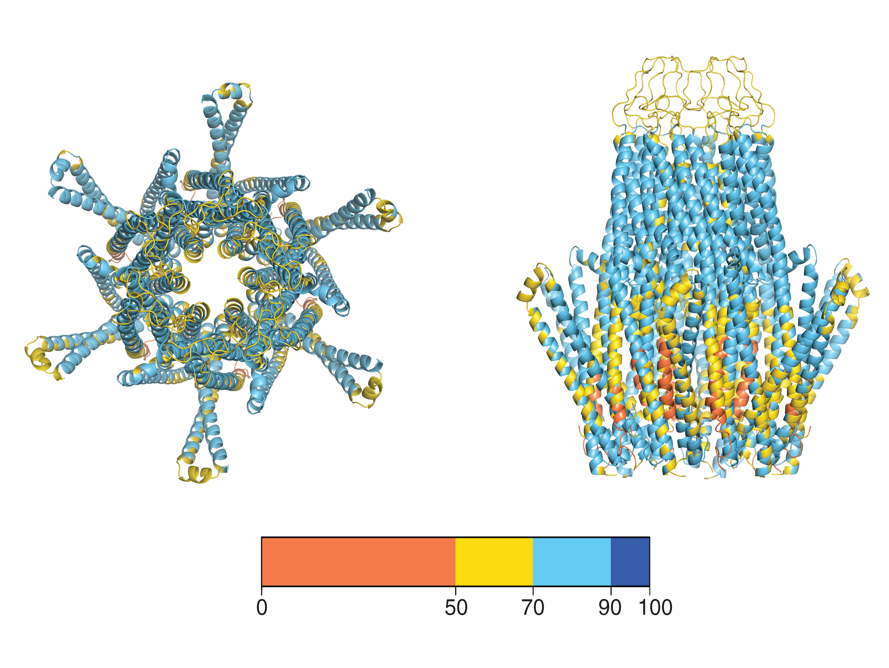

# Orai1–STIM1 CRAC Channel: Structural Modeling & Molecular Dynamics

Structural modeling and molecular dynamics (MD) simulation pipeline for the
**Orai1 hexameric channel bound to the STIM1 CRAC-activation domain (CAD)**,
the calcium-release-activated calcium (CRAC) channel complex. The pipeline
goes from sequence to a simulation-ready membrane system in three stages:
AI-based structure prediction (Boltz-2), and CHARMM-GUI/OpenMM molecular 
dynamics with downstream trajectory analysis.



*Boltz-2 prediction of the Orai1 hexamer (chains A–F) bound to twelve copies
of the STIM1 CRAC-activation domain (CAD, chains G–R), colored by
per-residue pLDDT confidence (orange = low, blue = high). Top view (left)
and side view (right). A vector version is available at
[`docs/figures/orai1_stim1_hexamer_cad_pLDDT.pdf`](docs/figures/orai1_stim1_hexamer_cad_pLDDT.pdf).*

## Repository layout

```
.
├── 01_boltz2_structure_prediction/   Stage 1 — Boltz-2 structure prediction
├── 02_molecular_dynamics/            Stage 2 — CHARMM-GUI system build, OpenMM MD, analysis
└── docs/figures/                     Figures for this README
```

## Software

- [Boltz-2](https://github.com/jwohlwend/boltz) — structure prediction
- [Biopython](https://biopython.org/), [PDBFixer](https://github.com/openmm/pdbfixer), [OpenMM](https://openmm.org/) — structure preparation, minimization, and MD
- [CHARMM-GUI](https://charmm-gui.org) — membrane system building (CHARMM36 force field)
- [MDAnalysis](https://www.mdanalysis.org/) — trajectory analysis (RMSD, RMSF, distances)
- [PyEMMA](http://emma-project.org/) — featurization
- [FoldX](https://foldxsuite.crg.eu/) — ΔΔG mutation scanning
- Python 3.10

## License

## License

- **Code** in this repository is released under the [MIT License](LICENSE).
- **Data** (modeled structures, coordinates, and other generated datasets) is released under
  [CC BY 4.0](https://creativecommons.org/licenses/by/4.0/) — you are free to use and redistribute
  it with attribution.

## Contact

Ella — honghanguyen1711@gmail.com
